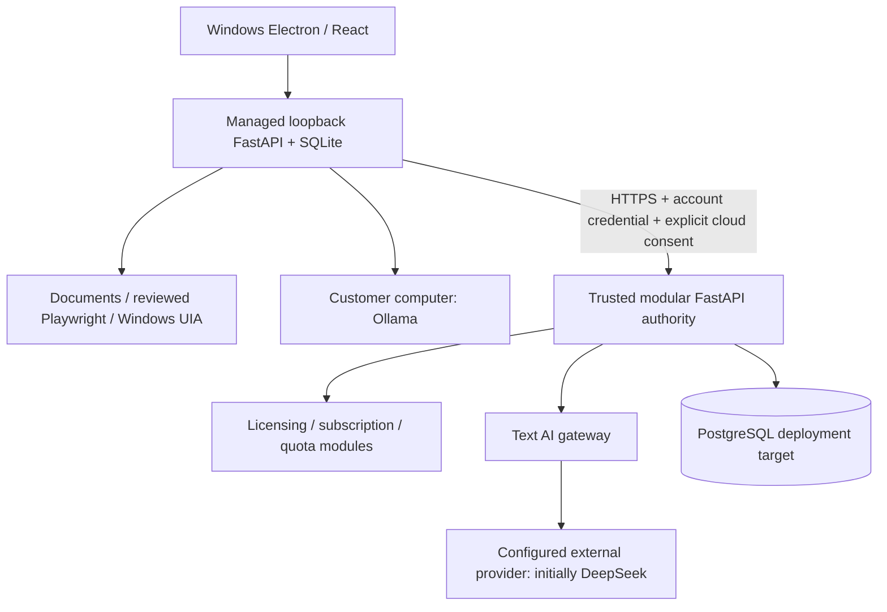

# Architecture: existing system and next changes

Audit baseline `ca68b44`, 2026-11-01. Retain the current stack. The diagrams describe trust boundaries; proposed records/adapters are not implemented features.

The desktop also supports customer BYOK requests directly to its configured HTTPS provider. Shared NightBrew keys belong exclusively on the authority. SQLite holds local chat, files, task payloads, employees and a cached signed grant; it cannot authorize paid entitlements. A local machine administrator is outside the desktop's tamper-resistance boundary. Current account bearer authentication is not a multi-user organization identity system.

Initial target: one 2-vCPU/4-GB Ubuntu LTS VPS, no model inference, one API process, PostgreSQL and Caddy in Compose. Use a stable domain, private database network and persistent volumes. Actual resource capacity, deployment and backups remain unverified. No separate server per plan. Stage 2 increases resources with tested backup/restore and planned downtime; Stage 3 may add API replicas, separate database and workers when measured load justifies it. Current advisory locks serialize quota writes and may limit throughput.

Retain existing local document tools, approvals, employee permissions, connector adapters and installer lifecycle. Add, in order: exact trusted ledger/model registry; tenant identities and policy services; reviewed PO workflow; payment/operations acceptance. Provider adapters normalize text, usage and errors but advertise only verified capabilities. Requests must pass identity, subscription, capability, privacy, budget reservation and concurrency admission before inference. Tool execution independently rechecks immutable approvals/permissions; AI text never grants authorization.

Schema proposal: [REPOSITORY_AUDIT.md, section 9](REPOSITORY_AUDIT.md#9-database-changes-proposed-not-applied). Do not make destructive changes or rewrite applied migration 001. Introduce additive migrations with reconciliation, actual PostgreSQL tests and restore evidence first.

FieldOps remains a separate product and database. Its mobile authorization and sync features are not shared with this desktop today.
